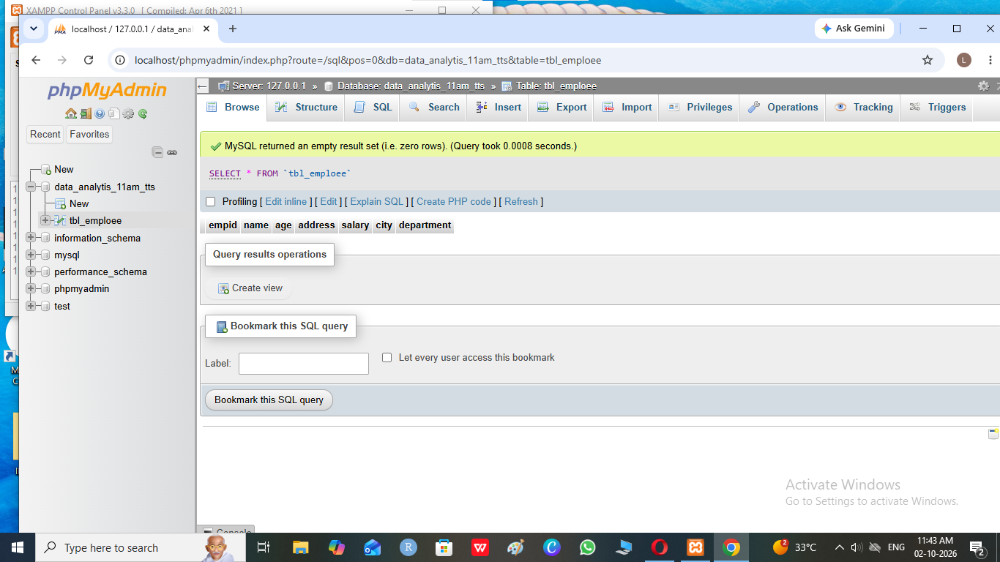
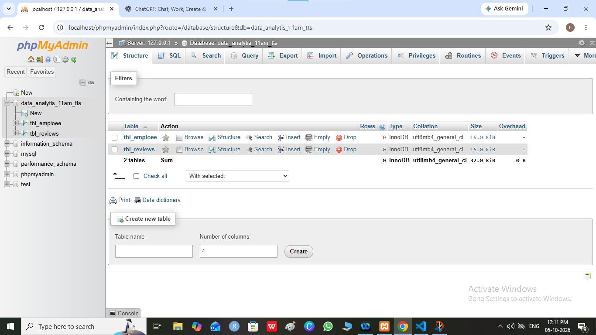

##what is sql ?
 1 sql stands for **strucherd query language**
 2 sql usde  for create database |tables strucher
 3 sql is a insentive query language
 **examplen**
 '''
    insert |INSERT|Isert

 '''

 4 sql is usde to cearte strucher of database and strucher and tables 
 via its **query of command **
 5 sql is create logics and functionl 
 6 sql exacute query
 7 sql create views or index to fast load data
 8 sql create  a structured data

      **structured data format column and rows **
      **exaamples**  

 | id  |     name  |  age |  addres
 ------|-----------|------|--------
 | 1   | priyanshu |   24 |  ret
 | 2   | priyanshu |      |
 | 3   | priyanshu |      |
 | 4   | priyanshu |      |
 | 5   | priyanshu |      |

 ##type  of sql quaey or commands

 1 **ddl(data defination language )
 2 **dml(data manipulation language)
 3 **dql(data quray language)
 4 **tcl(treansactionl control language)**

 #ddl(data defination language )
 1 stands for data dafinetion laguge 
 2 create an structurd of database and tables
 3 rename  table 
 4 update | add    | modify | dorp data in table or colums in tables
 5 truncate data form tables

  ** ddl quary are**

  1 create
  2 alter
  3 rename
  4 drop
  5 trucate
  6 chnage

2 # How to create database and  table strucher?
   

  1 create a database 
    **sytex**
    '''
       create database databasename;
    '''
    **examples**

    '''
      create database data_analytics_11am_tts
    '''

   2 create table table strutcured

    **sytex**
   '''
     create table tablename
     (
      id datatype(size) auto_incriment primary key,
      columname dtatype (size),
      .
      .
      .
      .
      .
      .
      .
      colums datatype(size)

     ); 
   '''
    '''

      **examples**
    '''
        create table tbl_employee (
         empid int AUTO_INCRIMENT primary key,
         name   varchar(255),
         age int,
         address text,
         salary decimal(10,2),
         city vaechar(100),
         department varchar(200),

        );
        
    '''
 create table tbl_reviews(
        
    )

   i |         cloumname |        datatype     |       description 
    --------------------|---------------------|-----------------------
    |    id             |    nt(defult size) | accept integer
    |    name           | char,varchar(0-255) | char accept             charecter      only and yarcher accept character and numbers both 
    

    Column Name	Datatype	Description
id	INT	Stores whole numbers, such as 1, 100, or 5000.
name	CHAR(n)	Stores a fixed-length string. Can contain letters, numbers, spaces, and symbols.
name	VARCHAR(n)	Stores a variable-length string. Can contain letters, numbers, spaces, and symbols.
age	INT	Stores a person's age as a whole number.
salary	DECIMAL(p,s)	Stores exact decimal numbers, commonly used for money.
price	DECIMAL(p,s)	Stores exact values with decimal places, such as 99.99.
quantity	INT	Stores a whole-number quantity, such as 10 or 500.
description	TEXT	Stores a large amount of text.
email	VARCHAR(n)	Stores an email address, such as user@example.com.
phone	VARCHAR(n)	Stores phone numbers. VARCHAR is preferred because phone numbers can contain +, spaces, or -.
address	VARCHAR(n) / TEXT	Stores an address.
city	VARCHAR(n)	Stores a city name.
state	VARCHAR(n)	Stores a state or province name.
country	VARCHAR(n)	Stores a country name.
pincode	VARCHAR(n)	Stores postal/PIN codes. VARCHAR is useful because codes may contain leading zeros.
gender	CHAR(1) / VARCHAR(n)	Stores gender or another short categorical value.
status	VARCHAR(n)	Stores a status such as active, inactive, or pending.
is_active	BOOLEAN	Stores a true/false value, such as TRUE or FALSE.
date	DATE	Stores a date, such as 2026-10-05.
time	TIME	Stores a time, such as 11:30:00.
created_at	DATETIME / TIMESTAMP	Stores the date and time when a record was created.
updated_at	DATETIME / TIMESTAMP	Stores the date and time when a record was last updated.
birth_date	DATE	Stores a person's date of birth.
year	YEAR	Stores a year, such as 2026.
small_number	SMALLINT	Stores smaller whole numbers than INT.
big_number	BIGINT	Stores very large whole numbers.
float_value	FLOAT	Stores approximate decimal/floating-point numbers.
double_value	DOUBLE	Stores approximate decimal numbers with higher precision than FLOAT.
binary_data	BLOB	Stores binary data, such as files or images.
json_data	JSON	Stores data in JSON format.
uuid	UUID	Stores a universally unique identifier, depending on database support.

**create a 5 tables**
** tbl_reviews**
'''
CREATE TABLE tbl_reviews (
    rid INT AUTO_INCREMENT PRIMARY KEY,
    name VARCHAR(250),
    email VARCHAR(255),
    phone VARCHAR(20),
    rating ENUM('*', '**', '***', '****', '*****'),
    comment TEXT
);
'''
'''
  
'''
# create the thinks in workbench database

